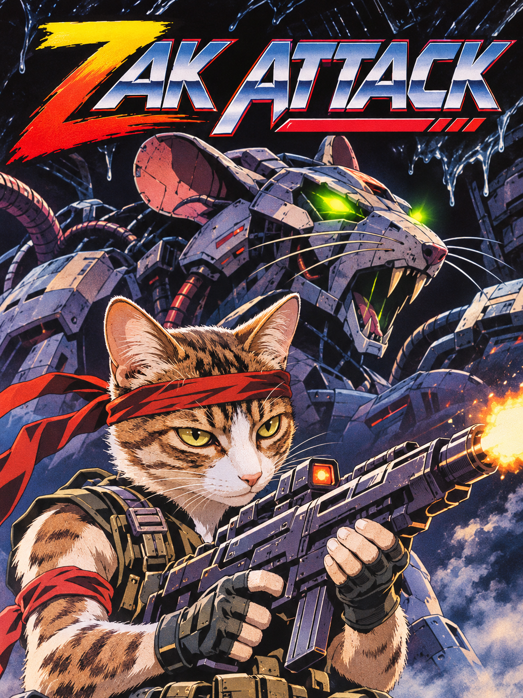

# ZAK ATTACK

**GATO. COMANDO. CAOS.**

Run'n'Gun felino para **Atari 8 bits** (400/800/XL/XE, 48 KB). © 2026 Tony C. Ware.

## La historia

**EL GATO QUE SALVÓ AL MUNDO.** Zak, un gato feliz que adoraba dormir y recibir sus galletitas de salmón, descubre que Industrias Rata quiere ejecutar su plan de **Asedio Global** para eliminar a todos los michis. Entonces Zak… **COGIÓ SU FUSIL.**

[Leer la historia completa](HISTORIA.md).

## Descargas — V1.0

Descarga los archivos jugables desde la [Release V1.0](../../releases/tag/v1.0):

| Archivo | Descripción |
|---|---|
| `zakattack.xex` | Ejecutable Atari 8-bit |
| `zakattack.atr` | Disco autoarrancable sin DOS |
| `zakattack.car` | Cartucho AtariMax 128 KB, tipo 41 |
| `ZAK_ATTACK_Atari8bits_V1.0_PROYECTO_COMPLETO.zip` | Fuentes, documentación, capturas y banda sonora |

Diseñado y probado con Atari800 NTSC, XL 64 KB. Funciona en PAL a velocidad algo inferior.

## Las cinco fases

1. **Callejón Neón** — MEKDOZER 1.
2. **Metro** — METROPLEX III.
3. **Factoría del Miedo** — CONTROL CENTRAL II.
4. **Planta Química** — QUIMERA-9.
5. **Industrias Rata** — RATTUS PRIME.

Tres dificultades: FÁCIL, NORMAL y HARDCORE. Pescados para recuperar vida y latas doradas para conseguir vidas extra.

## Controles

- Joystick izquierda/derecha: correr; arriba: saltar; abajo: agacharse.
- FIRE en movimiento: disparo recto.
- FIRE detenido: apuntar con joystick en varias direcciones.
- P o ESPACIO: pausa.
- En el título: izquierda/derecha seleccionan dificultad; FIRE inicia el juego.

## Material incluido

- [Instrucciones ilustradas (PDF)](documentacion/ZAK_ATTACK_Instrucciones.pdf)
- [Atlas visual del proyecto (PDF)](documentacion/ZAK_ATTACK_Atlas_visual.pdf)
- [Capturas reales](documentacion/capturas/)
- [Código fuente 6502 y utilidades](codigo_fuente/)
- [Ocho pistas de la banda sonora](banda_sonora/)
- [Banco de trabajo Atari 8-bit](banco_de_trabajo_atari8bits/)

Para recompilar consulta `codigo_fuente/LEEME.md`. El script de compilación utiliza `cc65`.

## Créditos

- **Diseño, fases, historia y arte:** Tony C. Ware (2026).
- **Música:** Yo, Claudio.
- **Programación y adaptación Atari 8-bit:** Claude A.I.
- **Protagonista:** Zak, el gato.

Consulta el archivo `LICENSE` para los términos de licencia del repositorio; los derechos sobre las ilustraciones, música y marcas pueden ser independientes. Proyecto aficionado y no oficial.
